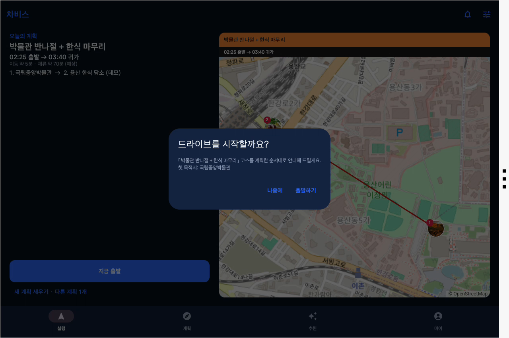
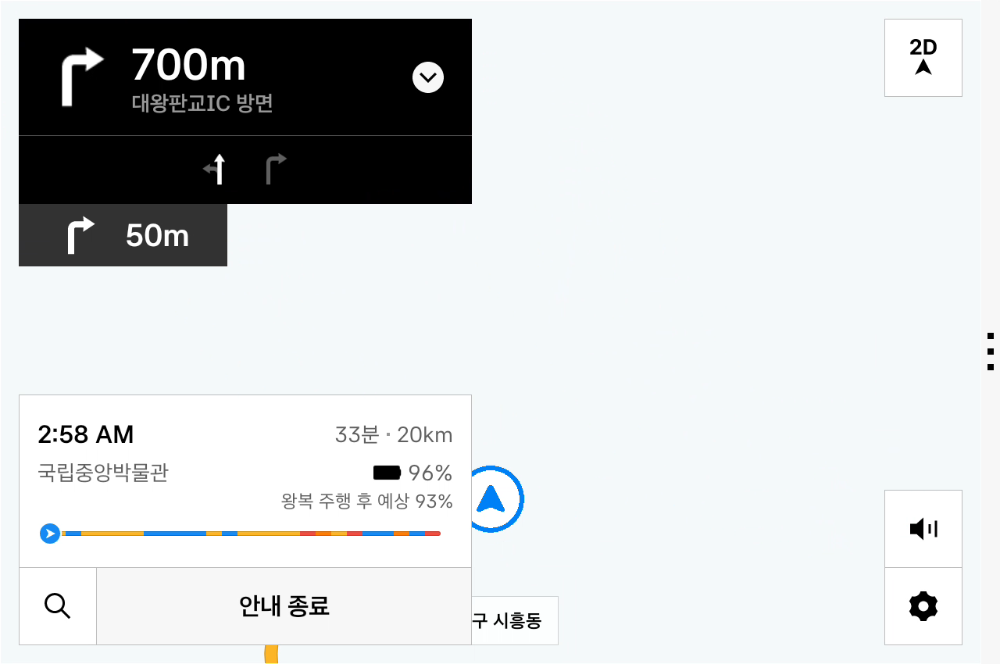
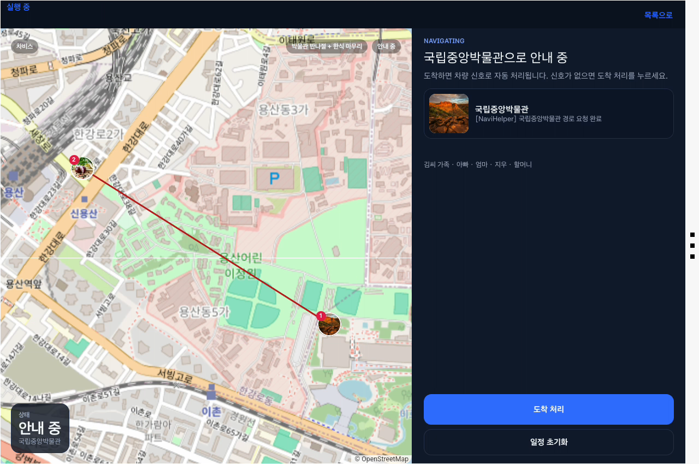
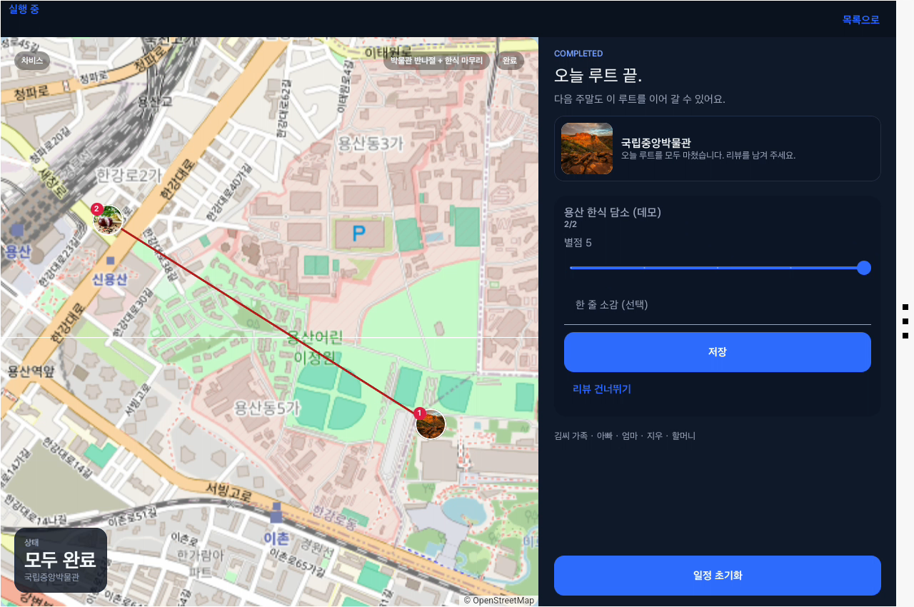

# 차비스 — 가족 나들이 드라이브 코스 비서

> 내비는 길을, 차비스는 가족의 다음 장소를 이어 줍니다.

현대자동차그룹 차량용 앱 개발 공모전(Pleos Connect) 출품작 · 일반 부문 · 개인 참가.
평일에 휴대폰 앱으로 주말 나들이 코스를 계획해 두면, 주말에 차에 시동을 걸 때 그 계획을 띄워 바로 출발하고, 드라이브 내내 다음 장소를 차가 이어서 안내하고, 집에 돌아오면 만족도를 받아 다음 코스 추천에 반영합니다.

## 사용 흐름

1. **평일에 휴대폰으로 계획**: 수요일 밤처럼 미리, 휴대폰에서 테마 코스(아이와 함께, 힐링, 맛집…)를 골라 일정을 잡으면 이번 주 토요일 오전으로 저장되고 "그날 차에 시동을 걸면 바로 안내해 드려요"라고 알려 줍니다.
1. **주말에 시동 → 드라이브 시작**: 차에서 차비스가 켜지면(시동 ON) 예정된 코스를 찾아 **"계획한 드라이브가 있어요"** 팝업을 띄웁니다. **출발하기**를 누르면 계획한 순서대로 첫 목적지를 안내합니다. 차에서 바로 코스를 잡으면 **"드라이브를 시작할까요?"** 팝업이 뜹니다.
2. **차량 내비로 바로 안내**: 첫 목적지를 Pleos 시스템 내비(NaviHelper)에 넘겨, 다시 검색하지 않아도 길 안내가 시작됩니다.
3. **도착 → 다시 시동 → 다음 장소**: 도착하면(내비 도착 신호 또는 주차 P) 도착으로 처리합니다. 구경을 마치고 다시 출발(기어 P→D)하면 화면을 누르지 않아도 "다음 목적지, ○○로 안내를 시작합니다"를 음성으로 알리고 다음 경로를 내비에 요청합니다. 앱이 꺼졌다 켜져도(시동 OFF/ON) 진행 상태를 복원해 다음 목적지를 제안합니다.
4. **귀가 후 리뷰**: 마지막 장소를 마치고 출발하면 오늘 루트가 끝납니다. 집에 도착해 차를 세우면(주행 중에는 잠금) 장소별 별점과 한 줄 소감으로 만족도를 남기고, 이 리뷰는 다음 코스 추천에 가중치로 반영됩니다.

| 시동을 걸면 뜨는 드라이브 팝업 | 차량 내비 안내 |
|---|---|
|  |  |
| **안내 중 (다음 장소 자동 안내)** | **루트 완료 후 리뷰** |
|  |  |

## 제출물

| 항목 | 위치 |
|---|---|
| 사용 시연 영상 (1분 58초, 평일 휴대폰 계획 → 주말 시동, 앱 화면은 실제 APK 녹화) | [demo/chavis-usage.mp4](demo/chavis-usage.mp4) |
| APK | GitHub Releases `v0.2.0` — `chavis-0.2.0.apk` |
| 기획서 | [docs/proposal.md](docs/proposal.md) |
| 소스 | `app/` |
| 시연 재현 | [docs/run.md](docs/run.md) |

## 실행

```bash
adb install -r chavis-0.2.0.apk
adb shell am start -n com.peyya.app/.MainActivity
```

첫 화면에서 **바로 체험하기**를 누르면 가입 없이 데모 가족으로 들어갑니다(데모 계정 `demo@peyya.app` / `peyya`).

## Pleos SDK 활용

| SDK | 사용처 |
|---|---|
| NaviHelper 3.0.5 | `requestRoute`로 장소별 경로 요청 · `onDestinationArrived`/`onWayPointArrived`로 자동 도착 처리 |
| Vehicle 2.3.2 (Gear) | P→D를 재출발(시동) 신호로, D→P를 도착 신호로 사용 · 주행(D/R) 중에는 계획·추천·리뷰 편집 잠금 |
| TextToSpeech | 다음 목적지 제안, 루트 완료 안내 |

Pleos에는 시동 ON/OFF API가 없어서, **기어 P→D**와 **앱 재실행 시 진행 상태 복원** 두 신호로 "다시 시동하면 다음 장소" 경험을 만들었습니다. NaviHelper가 4초 안에 연결되지 않으면 Mock으로 전환해 폰에서도 시연할 수 있습니다(`--ez force_mock true`).

## 테스트 환경

| 항목 | 내용 |
|---|---|
| Pleos Connect 에뮬레이터 | 2.1.0 (Android 14, API 34, arm64) · 1920×1080 |
| 추가 확인 | Android 14 폰 에뮬레이터 1080×2400 (세로는 폰 UI, 가로는 차량 UI) |
| 개발 환경 | JDK 17 · AGP 8.8 · Gradle 8.10.2 · Kotlin 2.0 · Jetpack Compose · compileSdk/targetSdk 35 · minSdk 28 |
| Maven | `https://nexus-playground.pleos.ai/repository/maven-releases/` |

## 빌드

```bash
./gradlew testDebugUnitTest   # 단위 테스트
./gradlew assembleRelease     # app/build/outputs/apk/release/app-release.apk
```

## 구조

```
app/src/main/java/com/peyya/app/
  domain/     TripPhase · DriveSignals(기어→도착/재출발) · PlanEngine · CourseRecommender(리뷰 가중 추천)
  data/       AppRepository · TripProgressStore(진행 상태 저장/복원) · SeedCatalog
  service/    PleosNaviGateway · ResilientNaviGateway(Pleos↔Mock) · VehicleIgnitionGateway(기어) · SpeechGuide
  viewmodel/  TripViewModel(주행 상태 머신) · TripReviewReducer · AppViewModel
  ui/         auth · plan · execute · recommend · my · CarTripScreen(가로/차량) · PhoneTripScreen(세로)
tools/demo/   시연 녹화(record_weekly.py)·영상 합성(make_weekly_video.py)
```

휴대폰과 차의 계획 동기화(Pleos 계정 연동)는 개발 예정입니다. 시연에서는 차량 에뮬레이터에도 같은 코스를 미리 저장해 두었습니다.
패키지 이름(`com.peyya.app`)은 개발 당시 이름을 그대로 쓰고, 화면에 보이는 서비스 이름은 차비스입니다.
데모 장소는 근사 좌표이고, 「용산 한식 담소」는 가상 장소입니다. 지도 데이터 © OpenStreetMap contributors.
